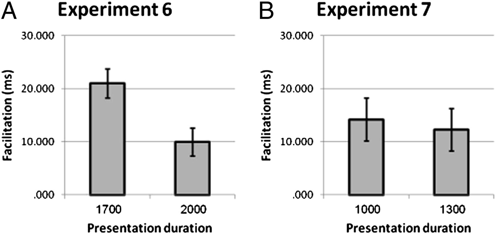

> Workshop materials drafted with Claude Opus 5.5 for Psych 251.

## Background

Sklar et al. (2012, *PNAS*) claimed that people can solve arithmetic problems they never
consciously see. Using continuous flash suppression, they flashed an arithmetic problem
(the *prime*, e.g. `=9-3-4`) to one eye while the other eye saw rapidly changing patterns
that kept the prime out of awareness. Participants then read aloud a *target* number as
fast as they could. If the target was the answer to the prime (*congruent* trials), were
they faster?

Experiment 6 is the key evidence. The paper reports faster naming after congruent
subtraction primes, but not after addition primes, and argues that subtraction, as the
harder operation, leaves more of a trace. Participants who reported seeing the primes, or
who could guess their parity above chance, were excluded. Here is the paper's figure:

{width=60%}

## The data

```{r}
#| message: false
library(tidyverse)
d <- read_csv("sklar2012_expt6.csv")
glimpse(d)
```

The columns are described in `codebook.md`. Operation and congruence vary *within*
participants; presentation time varies *between* participants.

## How we'll work

Work in pairs. Let an agent write the code; your job is to decide what to plot and to judge
the result. Give your agent the [Experimentology visualization chapter](https://experimentology.io/015-viz.html)
and the three principles from Monday: **show the experiment, facilitate comparison, use less
ink**. Iterate fast: ask for several versions, say exactly what you don't like, and keep the
ones you would defend.

After each round, save your best plot and write one sentence: what does it show, and what
is still wrong with it?

## Round 1: look before you summarize

- What do the response times look like? Plot their distribution. Does anything about the
  values surprise you?
- Plot the two awareness checks for all 42 participants, and show who is excluded.

## Round 2: show the experiment

- Make a plot of the full design (operation × congruence × presentation time) for the 17
  included participants, with the individual participants visible, not only the means.
- This is a within-participant design. What should the error bars be? Try at least two
  options (for example, standard CIs, participant lines, and difference scores) and decide
  which tells the truth best.

## Round 3: facilitate comparison

- The claim is about the *facilitation effect*: incongruent minus congruent RT. Plot it for
  each participant, by operation and presentation time.
- Put your plot next to the paper's figure. What does yours show that theirs hides?

## Round 4: change the unit

- Every trial is a particular prime and target. Make plots where the unit is the *item*
  rather than the participant. What varies across items? Besides congruence, is there
  anything that differs between the addition and subtraction trials?

## Stretch: do the exclusions matter?

- Show the facilitation effect for all 42 participants and for the 17 included, as small
  multiples. Does the conclusion depend on who is excluded?

## What to share

One figure you would put in a paper about these data, with a one-sentence caption that
states what it shows. Add it to the class slide deck.
